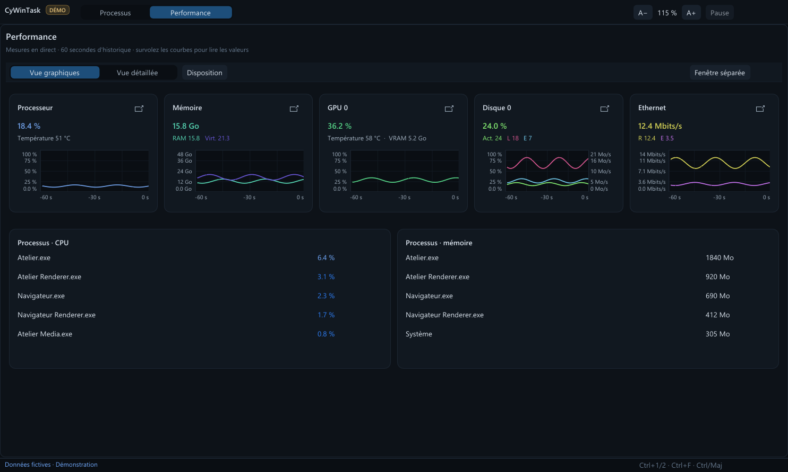
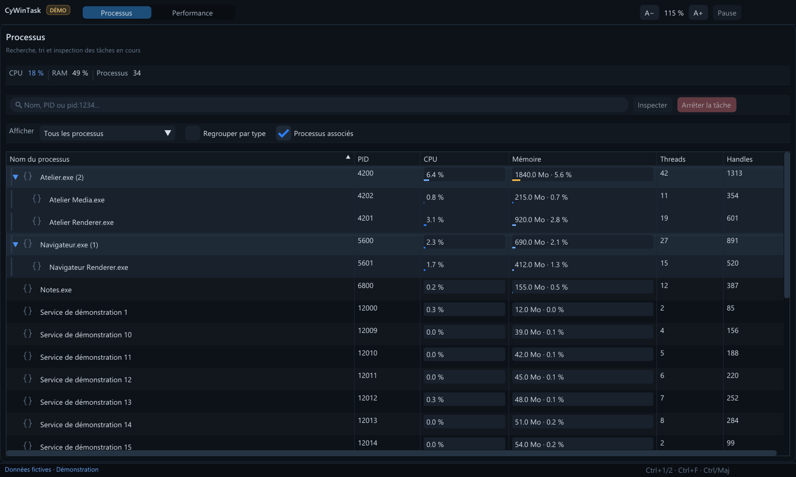

<p align="center"></p>
<h1 align="center">CyWinTask</h1>
<p align="center"><strong>Windows x64 · <a href="VERSION.fr.md">0.7.0</a> · En développement</strong></p>
<p align="center">
  <a href="https://github.com/MrMybal/CyWinTask/releases/download/v0.7.0/CyWinTask-0.7.0-win-x64-setup.exe">Installateur</a> ·
  <a href="https://github.com/MrMybal/CyWinTask/releases/download/v0.7.0/CyWinTask-0.7.0-win-x64-portable.zip">ZIP portable</a> ·
  <a href="https://github.com/MrMybal/CyWinTask/releases">Versions publiées</a> ·
  <a href="LICENSE">Licence AGPL-3.0</a>
</p>
<p align="center"><a href="README.md">English</a> · <a href="README.fr.md">Français</a></p>

CyWinTask est un gestionnaire de tâches Windows x64 pour inspecter les processus et suivre l’activité du système en temps réel. L’interface distribuée utilise Dear ImGui, CyUI et Direct3D 11 ; un collecteur .NET 8 séparé fournit les mesures Windows.

> **EN DÉVELOPPEMENT · 0.7.0**
>
> La version native Windows est disponible pour les essais et l’analyse. Certaines fonctions du Gestionnaire de tâches restent à développer ; consulter les [notes de version et limites connues](VERSION.fr.md).

[](docs/screenshots/performance.png)

## L’application

La page **Processus** recherche par nom ou PID, trie chaque colonne, filtre ou regroupe les types de processus et déplie les relations parent/enfants. Sélectionner plusieurs lignes avec Ctrl ou Maj pour consulter les détails ou utiliser les actions du clic droit. Les barres CPU et mémoire montrent la charge relative ; les icônes apparaissent quand elles sont accessibles. L’arrêt demande confirmation et vérifie de nouveau l’identité du processus. Les enfants ne sont pas arrêtés implicitement.

La page **Performance** affiche le CPU, la mémoire physique et virtuelle engagée, les disques, le réseau et le GPU. La vue graphiques rassemble plusieurs ressources à l’écran, avec grilles, échelles, repères temporels et valeurs au survol. On peut passer à une vue détaillée ou ouvrir le tableau de bord, voire un seul graphique, dans une fenêtre séparée. Les températures CPU et GPU apparaissent uniquement si un capteur compatible les fournit.

[](docs/screenshots/processes.png)

Les deux captures proviennent directement du mode `--demo` de CyWinTask, avec des processus et des valeurs matérielles fictifs.

## Fonctionnalités

- **Analyse des processus :** recherche, tri, regroupement facultatif par type, arborescence des processus associés, multisélection et détails avancés.
- **Surveillance compacte :** cartes CPU, RAM, GPU, disque et réseau, graphiques détaillés et fenêtres détachables.
- **Mesures en direct :** jusqu’à 60 secondes d’historique ; les compteurs manquants sont indiqués comme indisponibles.
- **Interface réglable :** thèmes, densité compacte ou confortable et commandes de zoom dans la barre supérieure.

---

## Installation

L’application publiée cible Windows x64. L’installateur est configuré pour Windows 10 ou plus récent. Le runtime .NET nécessaire au collecteur est inclus : les téléchargements ne nécessitent pas d’installation .NET séparée.

1. Télécharger l’[installateur 0.7.0](https://github.com/MrMybal/CyWinTask/releases/download/v0.7.0/CyWinTask-0.7.0-win-x64-setup.exe) ou le [ZIP portable](https://github.com/MrMybal/CyWinTask/releases/download/v0.7.0/CyWinTask-0.7.0-win-x64-portable.zip).
2. Lancer l’installateur ou extraire le ZIP portable **entièrement** dans un dossier.
3. Démarrer `CyWinTask.exe`. Pour le portable, conserver le dossier `bridge` à côté de l’exécutable.

L’installateur ajoute un raccourci au menu Démarrer et propose un raccourci bureau. CyWinTask ne remplace pas le Gestionnaire de tâches Windows ni ses raccourcis clavier. Voir la [version publiée et ses sommes de contrôle](https://github.com/MrMybal/CyWinTask/releases/tag/v0.7.0).

## Sources, compilation et bibliothèques nécessaires

<details>
<summary>Compiler l’application native sous Windows</summary>

Installer le SDK .NET 8 et Visual Studio 2022 avec les outils C++, CMake et Ninja. La compilation demande aussi un accès au [dépôt CyUI](https://github.com/MrMybal/CyUI), qui est **privé** ; le commit exact est indiqué dans [native/CYUI_REVISION](native/CYUI_REVISION). La copie de CyUI n’est pas incluse dans ce dépôt de sources. Inno Setup 6 sert uniquement à construire l’installateur.

```powershell
git clone https://github.com/MrMybal/CyWinTask.git
cd CyWinTask
powershell -NoProfile -ExecutionPolicy Bypass -File native/Sync-CyUI.ps1
powershell -NoProfile -ExecutionPolicy Bypass -File native/Build-Native.ps1
./dist-native/CyWinTask.exe
```

`Build-Native.ps1 -Offline` utilise les paquets NuGet déjà présents dans le cache local. Pour construire un installateur et un ZIP portable, lancer `packaging/Build-Release.ps1 -Version 0.7.0` avec Inno Setup 6 disponible. L’ancienne interface WPF reste dans les sources, mais les paquets 0.7.0 publiés lancent l’interface native.

</details>

---

## Licence

CyWinTask utilise la [licence publique générale GNU Affero v3.0](LICENSE). Les composants tiers conservent leurs propres conditions. Ce tableau présente les composants principaux de la version native publiée ; les notices complètes sont incluses dans le dossier `licenses` de l’application téléchargée.

| Bibliothèque · sources | Licence · texte | Utilisation / périmètre |
| --- | --- | --- |
| [CyUI](https://github.com/MrMybal/CyUI) · sources 1.2.0 figées, dépôt privé | MIT ; `licenses/CyUI.txt` dans le téléchargement | Modules d’interface natifs Core, Plots et Canvas. |
| [Dear ImGui](https://github.com/ocornut/imgui) · intégré à CyUI | [MIT](https://github.com/ocornut/imgui/blob/master/LICENSE.txt) ; `licenses/Dear-ImGui.txt` dans le téléchargement | Rendu de l’interface native. |
| [En-têtes stb de texte et de disposition](https://github.com/nothings/stb) · intégrés à Dear ImGui | MIT **ou** domaine public, au choix ; textes dans `licenses/stb/` | Rendu des polices et aides de texte/disposition de Dear ImGui. |
| [Runtime .NET](https://github.com/dotnet/runtime) · 8.0.31 | [MIT](https://github.com/dotnet/runtime/blob/main/LICENSE.TXT) et notices des composants | Runtime inclus pour le collecteur séparé. |
| [System.Management](https://www.nuget.org/packages/System.Management/8.0.0) · 8.0.0 | [MIT](https://github.com/dotnet/runtime/blob/main/LICENSE.TXT) et notices des composants | Données de gestion Windows utilisées par le collecteur. |
| [System.CodeDom](https://www.nuget.org/packages/System.CodeDom/8.0.0) · 8.0.0 | [MIT](https://github.com/dotnet/runtime/blob/main/LICENSE.TXT) et notices des composants | Dépendance transitive du collecteur. |

Le SDK .NET, les outils C++ de Visual Studio et Inno Setup servent à la compilation et ne sont pas nécessaires pour exécuter les paquets publiés. Ce tableau est un index ; il ne remplace pas les notices fournies avec l’application.

## Références et liens

- [Dépôt des sources](https://github.com/MrMybal/CyWinTask) · [Versions publiées](https://github.com/MrMybal/CyWinTask/releases) · [Suivi des problèmes](https://github.com/MrMybal/CyWinTask/issues).
- [Notes de version](VERSION.fr.md) · [English](README.md).
- API Windows : [NtQuerySystemInformation](https://learn.microsoft.com/windows/win32/api/winternl/nf-winternl-ntquerysysteminformation), [compteurs PDH](https://learn.microsoft.com/windows/win32/api/pdh/nf-pdh-pdhgetformattedcounterarrayw), [DXGI](https://learn.microsoft.com/windows/win32/api/dxgi/ns-dxgi-dxgi_adapter_desc1).
