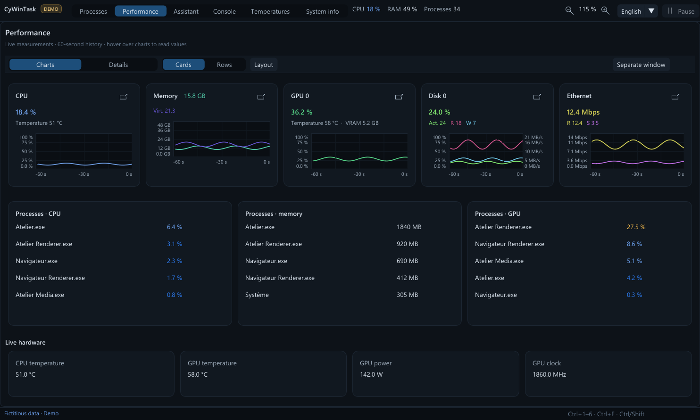
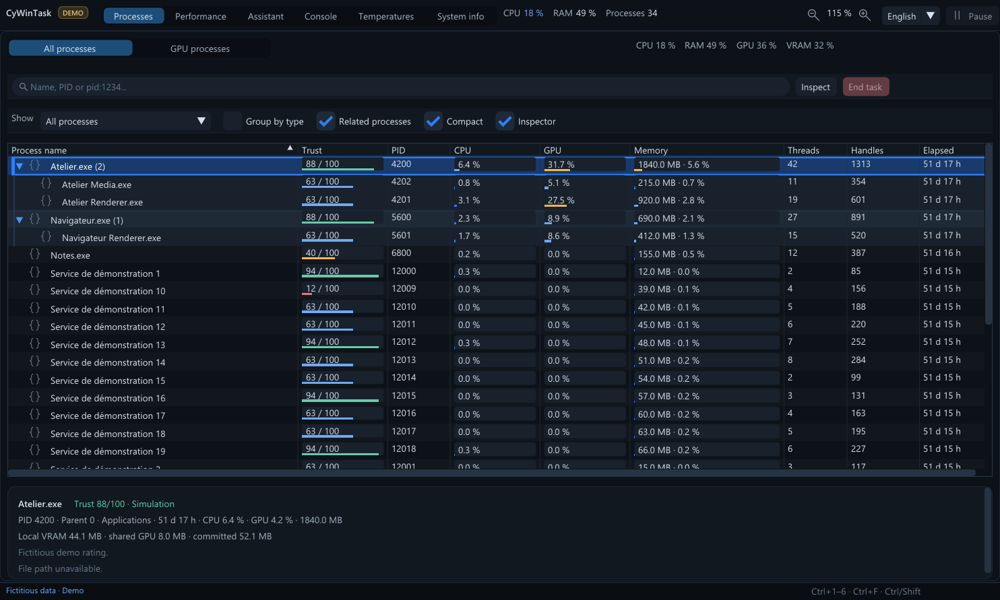

<p align="center"></p>
<h1 align="center">CyWinTask</h1>
<p align="center"><strong>Windows x64 · 0.10.1 · En développement</strong></p>
<p align="center"><a href="https://github.com/MrMybal/CyWinTask/releases/download/v0.10.1/CyWinTask-0.10.1-win-x64-setup.exe">Installateur</a> · <a href="https://github.com/MrMybal/CyWinTask/releases/download/v0.10.1/CyWinTask-0.10.1-win-x64-portable.zip">ZIP portable</a> · <a href="https://github.com/MrMybal/CyWinTask/releases/tag/v0.10.1">Notes de version</a></p>
<p align="center"><a href="README.md">English</a> · <a href="LICENSE">GNU AGPL v3.0</a> · <a href="https://github.com/MrMybal/CyWinTask/issues">Problèmes</a></p>

CyWinTask est un gestionnaire de tâches Windows x64 pour inspecter les processus et suivre l’activité du système en temps réel. L’interface distribuée utilise Dear ImGui, CyUI et Direct3D 11 ; un collecteur .NET 8 séparé fournit les mesures Windows. CyMCPSDK assure l'intégration de l'Assistant et de MCP.

> **EN DÉVELOPPEMENT · 0.10.1**
>
> La version native Windows est disponible pour les essais et l’analyse. Certaines fonctions du Gestionnaire de tâches restent à développer ; consulter les [notes de version et limites connues](VERSION.fr.md).

[](docs/screenshots/performance.png)

## L’application

La page **Processus** recherche par nom ou PID, trie chaque colonne, filtre ou regroupe les types de processus et déplie les relations parent/enfants. Son mode compact affiche davantage de lignes, avec la durée et une note de confiance ; le panneau inférieur résume la sélection. Sélectionner plusieurs lignes avec Ctrl ou Maj pour consulter les détails ou utiliser les actions du clic droit. Les barres CPU, GPU et mémoire montrent la charge relative ; les icônes apparaissent quand elles sont accessibles. Son sous onglet **Processus GPU** regroupe les tâches par adaptateur et affiche la confiance, les charges CPU/GPU et les mémoires GPU locale et partagée. Chaque colonne se trie par clic ; un clic inspecte le processus et un double-clic le retrouve dans la liste principale. En liste plate, la colonne GPU mesure le processus seul ; dans l’arborescence, une ligne parent affiche la charge de sa branche, enfants compris. Le pourcentage correspond au moteur GPU le plus sollicité et affiche « — » si le compteur Windows est indisponible. L’inspection affiche aussi la VRAM locale, la mémoire GPU partagée et la mémoire GPU engagée par processus lorsque Windows expose ces compteurs. L’arrêt demande confirmation et vérifie de nouveau l’identité du processus. Les enfants ne sont pas arrêtés implicitement.

La note de confiance est un **indice local** fondé sur la vérification Authenticode et l’emplacement du fichier. La vérification se fait en arrière-plan, sans requête réseau de révocation. Une signature par catalogue Windows peut ne pas être confirmée par cette vérification. La note ne prouve pas qu’un processus est sûr ou malveillant ; le survol et le panneau d’inspection indiquent les éléments disponibles.

La page **Performance** affiche le CPU, la mémoire physique et virtuelle engagée, les disques, le réseau et le GPU. La vue graphiques rassemble plusieurs ressources à l’écran, avec grilles, échelles, repères temporels et valeurs au survol. On peut choisir des cartes compactes ou des lignes pleine largeur, des cartes ou des lignes dans les détails, ou détacher un graphique. CyHWInfo fournit l'activité CPU et RAM, la télémétrie GPU et les capteurs CPU, carte mère et mémoire disponibles ; les compteurs Windows servent de repli. La page **Températures** propose un tableau CyHWInfo détaillé avec valeurs actuelles, minimales, maximales et moyennes ; elle peut aussi lire un journal CSV HWiNFO. **Informations système** utilise CyHWInfo pour détailler CPU, mémoire, carte mère et GPU. La **Console** conserve une session CMD ou PowerShell entre les commandes, avec les droits de l’application. Un bouton explicite permet de la redémarrer en administrateur pour accéder à davantage de capteurs.

[](docs/screenshots/processes.png)

Les deux captures proviennent directement du mode `--demo` de CyWinTask, avec des processus et des valeurs matérielles fictifs.

Le [guide matériel](docs/Hardware.fr.md) détaille les colonnes des processus GPU, les capteurs disponibles et les conditions d'accès aux mesures avancées.

## Fonctionnalités

- **Analyse des processus :** recherche, tri, regroupement facultatif par type, arborescence des processus associés, utilisation GPU par processus ou branche, multisélection, note de confiance et détails avancés.
- **Surveillance compacte :** cartes CPU, RAM, GPU, disque et réseau, graphiques détaillés et fenêtres détachables.
- **Outils matériels :** températures, journal CSV HWiNFO optionnel, résumé du système et console CMD/PowerShell locale.
- **Mesures en direct :** jusqu’à 60 secondes d’historique ; les compteurs manquants sont indiqués comme indisponibles.
- **Interface réglable :** thèmes, densité compacte ou confortable et commandes de zoom dans la barre supérieure.
- **Assistant et automatisation :** chat intégré, CLI autonome et serveur MCP local pour les mesures, l'inspection des processus et le contrôle de l'interface. Quatre profils MCP locaux sont disponibles. Le profil Free par défaut accepte une connexion par adresse seule depuis les processus locaux et autorise tous les outils enregistrés sans confirmation supplémentaire ; le chat et les profils contrôlés conservent les droits individuels. Voir le [guide Assistant, CLI et MCP](docs/CyMCPSDK.fr.md).

---

## Installation

L’application publiée cible Windows x64. L’installateur est configuré pour Windows 10 ou plus récent. Le collecteur de processus embarque son runtime .NET. Les capteurs matériels avancés utilisent un pont .NET 8 séparé et demandent le [runtime .NET 8](https://dotnet.microsoft.com/download/dotnet/8.0). Les mesures natives restent disponibles sans lui. Certains capteurs bas niveau demandent également le [pilote PawnIO signé](https://pawnio.eu/) ; son installation est explicite et peut demander une validation Windows.

1. Télécharger l’[installateur 0.10.1](https://github.com/MrMybal/CyWinTask/releases/download/v0.10.1/CyWinTask-0.10.1-win-x64-setup.exe) ou le [ZIP portable](https://github.com/MrMybal/CyWinTask/releases/download/v0.10.1/CyWinTask-0.10.1-win-x64-portable.zip).
2. Lancer l’installateur ou extraire le ZIP portable **entièrement** dans un dossier.
3. Démarrer `CyWinTask.exe`. Pour le portable, conserver les dossiers `bridge` et `cyhwinfo-lhm` à côté de l’exécutable.

L’installateur ajoute un raccourci au menu Démarrer et propose un raccourci bureau. CyWinTask ne remplace pas le Gestionnaire de tâches Windows ni ses raccourcis clavier. Voir la [version publiée et ses sommes de contrôle](https://github.com/MrMybal/CyWinTask/releases/tag/v0.10.1).

## Sources, compilation et bibliothèques nécessaires

<details>
<summary>Compiler l’application native sous Windows</summary>

Installer le SDK .NET 8 et Visual Studio 2022 avec les outils C++, CMake et Ninja. La compilation demande aussi un accès aux dépôts **privés** [CyUI](https://github.com/MrMybal/CyUI), [CyMCPSDK](https://github.com/MrMybal/CyMCPSDK) et [CyHWInfo](https://github.com/MrMybal/CyHWInfo). Leurs commits sont fixés dans `native/` ; les sources privées ne sont pas incluses ici. Inno Setup 6 sert uniquement à construire l'installateur.

```powershell
git clone https://github.com/MrMybal/CyWinTask.git
cd CyWinTask
powershell -NoProfile -ExecutionPolicy Bypass -File native/Sync-CyUI.ps1
powershell -NoProfile -ExecutionPolicy Bypass -File native/Sync-CyMCPSDK.ps1
powershell -NoProfile -ExecutionPolicy Bypass -File native/Build-Native.ps1
./dist-native/CyWinTask.exe
```

`Build-Native.ps1` utilise un dépôt local `../CyHWInfo` à la révision fixée ou le clone avec l'authentification GitHub existante. `-Offline` utilise les paquets NuGet du cache local ; `-Checks` exécute les tests d'intégration locaux. Révisions : [CyUI](native/CYUI_REVISION), [CyMCPSDK](native/CYMCP_REVISION) et [CyHWInfo](native/CYHWINFO_REVISION). La compilation produit aussi `CyWinTaskCli.exe`. Le [guide d'intégration](docs/CyMCPSDK.fr.md) décrit les commandes et les connexions MCP. Pour construire localement l'installateur et le ZIP portable, lancer `packaging/Build-Release.ps1` avec Inno Setup 6 disponible. L'ancienne interface WPF reste dans les sources, mais les paquets publiés lancent l'interface native.

</details>

---

## Licence

CyWinTask utilise la [licence publique générale GNU Affero v3.0](LICENSE). Les composants tiers conservent leurs propres conditions. Ce tableau présente les composants principaux de la version native publiée ; les notices complètes sont incluses dans le dossier `licenses` de l’application téléchargée.

| Bibliothèque · sources | Licence · texte | Utilisation / périmètre |
| --- | --- | --- |
| [CyUI](https://github.com/MrMybal/CyUI) · sources 1.2.0 figées, dépôt privé | MIT ; `licenses/CyUI.txt` dans le téléchargement | Modules d’interface natifs Core, Plots et Canvas. |
| [Dear ImGui](https://github.com/ocornut/imgui) · intégré à CyUI | [MIT](https://github.com/ocornut/imgui/blob/master/LICENSE.txt) ; `licenses/Dear-ImGui.txt` dans le téléchargement | Rendu de l’interface native. |
| [CyMCPSDK](https://github.com/MrMybal/CyMCPSDK) · sources 0.7.2 figées, dépôt privé | `licenses/CyMCPSDK.txt` dans le téléchargement | Assistant, registre d'outils, chat et serveur MCP. |
| [CyHWInfo](https://github.com/MrMybal/CyHWInfo) · sources figées, dépôt privé | MIT ; `licenses/CyHWInfo.txt` dans le téléchargement | Inventaire CPU, GPU, mémoire et carte mère ; télémétrie GPU ; tableau des capteurs. |
| [LibreHardwareMonitor](https://github.com/LibreHardwareMonitor/LibreHardwareMonitor) · utilisé par CyHWInfo | MPL-2.0 ; notices dans `cyhwinfo-lhm/licenses/` | Capteurs CPU, carte mère et mémoire optionnels. |
| [nlohmann/json](https://github.com/nlohmann/json), [cpp-httplib](https://github.com/yhirose/cpp-httplib), [PicoSHA2](https://github.com/okdshin/PicoSHA2) · intégrés à CyMCPSDK | Textes dans `licenses/nlohmann-json.txt`, `licenses/cpp-httplib.txt` et `licenses/PicoSHA2.txt` | JSON, HTTP et hachage pour l'Assistant. |
| [En-têtes stb de texte et de disposition](https://github.com/nothings/stb) · intégrés à Dear ImGui | MIT **ou** domaine public, au choix ; textes dans `licenses/stb/` | Rendu des polices et aides de texte/disposition de Dear ImGui. |
| [Runtime .NET](https://github.com/dotnet/runtime) · 8.0.31 | [MIT](https://github.com/dotnet/runtime/blob/main/LICENSE.TXT) et notices des composants | Runtime inclus pour le collecteur séparé. |
| [System.Management](https://www.nuget.org/packages/System.Management/8.0.0) · 8.0.0 | [MIT](https://github.com/dotnet/runtime/blob/main/LICENSE.TXT) et notices des composants | Données de gestion Windows utilisées par le collecteur. |
| [System.CodeDom](https://www.nuget.org/packages/System.CodeDom/8.0.0) · 8.0.0 | [MIT](https://github.com/dotnet/runtime/blob/main/LICENSE.TXT) et notices des composants | Dépendance transitive du collecteur. |

Le SDK .NET, les outils C++ de Visual Studio et Inno Setup servent à la compilation et ne sont pas nécessaires pour exécuter les paquets publiés. Ce tableau est un index ; il ne remplace pas les notices fournies avec l’application.

## Références et liens

- [Dépôt des sources](https://github.com/MrMybal/CyWinTask) · [Versions publiées](https://github.com/MrMybal/CyWinTask/releases) · [Suivi des problèmes](https://github.com/MrMybal/CyWinTask/issues).
- [Notes de version](VERSION.fr.md) · [English](README.md).
- API Windows : [NtQuerySystemInformation](https://learn.microsoft.com/windows/win32/api/winternl/nf-winternl-ntquerysysteminformation), [compteurs PDH](https://learn.microsoft.com/windows/win32/api/pdh/nf-pdh-pdhgetformattedcounterarrayw), [DXGI](https://learn.microsoft.com/windows/win32/api/dxgi/ns-dxgi-dxgi_adapter_desc1).
