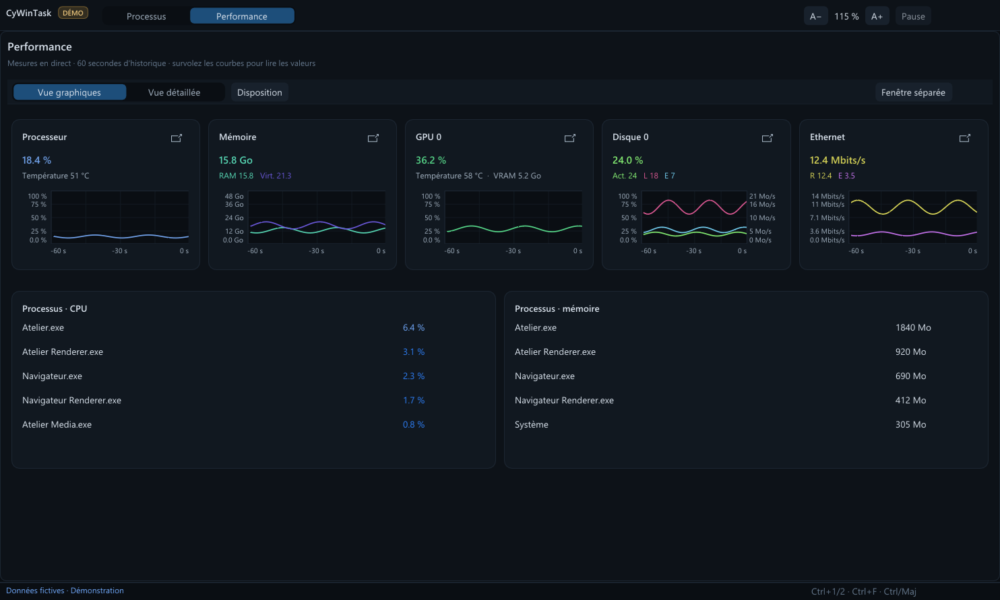
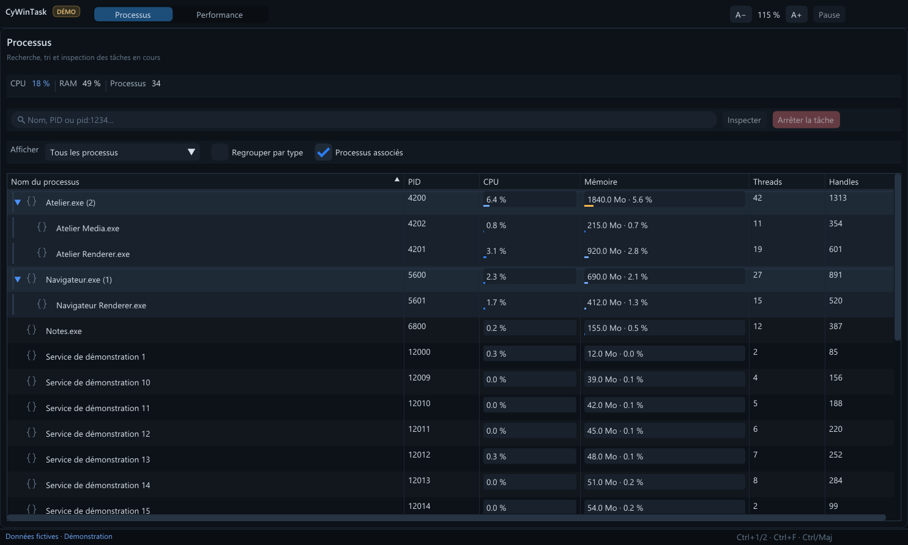

<table width="100%">
  <tr>
    <td width="30%" align="left" valign="top">
      <a href="https://github.com/MrMybal/CyWinTask">Repository</a><br>
      <a href="https://github.com/MrMybal/CyWinTask/issues">Issues</a><br>
      <a href="https://github.com/MrMybal/CyWinTask/releases">Releases</a><br><br>
      <sub>README</sub><br>
      <a href="README.md">English</a> · <a href="README.fr.md">Français</a>
    </td>
    <td width="40%" align="center" valign="middle">
      
    </td>
    <td width="30%" align="right" valign="top">
      <p><sub>Application license</sub><br><a href="LICENSE"><strong>GNU AGPL v3.0</strong></a></p>
      <p><sub>Version</sub><br><a href="VERSION.md"><strong>0.7.0</strong></a><br><strong>IN DEVELOPMENT</strong></p>
      <p><a href="https://github.com/MrMybal/CyWinTask/releases/download/v0.7.0/CyWinTask-0.7.0-win-x64-setup.exe"><strong>Installer</strong></a> · <a href="https://github.com/MrMybal/CyWinTask/releases/download/v0.7.0/CyWinTask-0.7.0-win-x64-portable.zip"><strong>Portable ZIP</strong></a><br><sub>Windows x64</sub></p>
    </td>
  </tr>
</table>

<h1 align="center">CyWinTask</h1>

CyWinTask is a Windows x64 task manager for inspecting running processes and following system activity in real time. Its distributed interface uses Dear ImGui, CyUI and Direct3D 11; a separate .NET 8 collector supplies Windows measurements.

> **IN DEVELOPMENT · 0.7.0**
>
> The native Windows build is available for testing and analysis. Some Task Manager features remain unfinished; read the [version notes and known limitations](VERSION.md).

[](docs/screenshots/performance.png)

## The application

The **Processes** page searches by name or PID, sorts each column, filters or groups process types, and expands related parent/child processes. Select rows with Ctrl or Shift, then inspect details or use the right-click menu for available actions. CPU and memory bars show relative load; process icons appear when accessible. Stopping a process requires confirmation and revalidates its identity. Children are not stopped implicitly.

The **Performance** page shows CPU, physical and committed virtual memory, disks, network and GPU. Its default graph view fits several resources on screen at once, with grids, value scales, time markers and hover readings. Switch to detailed resource views or open the dashboard or an individual graph in a separate window. CPU and GPU temperatures appear only when a compatible sensor provides them.

[](docs/screenshots/processes.png)

Both screenshots were captured directly from CyWinTask's `--demo` mode with fictional processes and hardware values.

## Features

- **Process analysis:** search, sorting, optional type grouping, related-process trees, multiselection and advanced details.
- **Compact monitoring:** CPU, RAM, GPU, disk and network cards, plus detailed graphs and detachable windows.
- **Live measurements:** up to 60 seconds of samples; missing counters are shown as unavailable rather than invented.
- **Adjustable interface:** display themes, compact or comfortable density, and zoom controls in the title bar.

---

## Installation

The published application targets Windows x64. The installer is configured for Windows 10 or later. The .NET runtime needed by the collector is included; no separate .NET installation is needed for the downloaded builds.

1. Download the [0.7.0 installer](https://github.com/MrMybal/CyWinTask/releases/download/v0.7.0/CyWinTask-0.7.0-win-x64-setup.exe) or [portable ZIP](https://github.com/MrMybal/CyWinTask/releases/download/v0.7.0/CyWinTask-0.7.0-win-x64-portable.zip).
2. Run the installer, or extract the **entire** portable ZIP to a folder.
3. Start `CyWinTask.exe`. For the portable build, keep the `bridge` folder beside it.

The installer adds a Start menu shortcut and offers an optional desktop shortcut. CyWinTask does not replace Windows Task Manager or its keyboard shortcuts. See the [release and checksums](https://github.com/MrMybal/CyWinTask/releases/tag/v0.7.0).

## Source, build and required libraries

<details>
<summary>Build the native application on Windows</summary>

Install the .NET 8 SDK and Visual Studio 2022 with C++ tools, CMake and Ninja. Building also requires access to the **private** [CyUI repository](https://github.com/MrMybal/CyUI); the exact commit is recorded in [native/CYUI_REVISION](native/CYUI_REVISION). The CyUI checkout is not included in this source repository. Inno Setup 6 is needed only to build the installer.

```powershell
git clone https://github.com/MrMybal/CyWinTask.git
cd CyWinTask
powershell -NoProfile -ExecutionPolicy Bypass -File native/Sync-CyUI.ps1
powershell -NoProfile -ExecutionPolicy Bypass -File native/Build-Native.ps1
./dist-native/CyWinTask.exe
```

`Build-Native.ps1 -Offline` uses locally cached NuGet packages. To build an installer and portable ZIP, run `packaging/Build-Release.ps1 -Version 0.7.0` with Inno Setup 6 available. The historical WPF interface remains in the source tree but is not the interface launched by the published 0.7.0 packages.

</details>

---

## License

CyWinTask uses the [GNU Affero General Public License v3.0](LICENSE). Third-party components keep their own terms. The table identifies the main components used by the published native build; the complete notices are included in the downloaded application's `licenses` folder.

| Library · source | License · terms | Use / scope |
| --- | --- | --- |
| [CyUI](https://github.com/MrMybal/CyUI) · pinned 1.2.0 source, private repository | MIT; `licenses/CyUI.txt` in the download | Native interface modules Core, Plots and Canvas. |
| [Dear ImGui](https://github.com/ocornut/imgui) · bundled with CyUI | [MIT](https://github.com/ocornut/imgui/blob/master/LICENSE.txt); `licenses/Dear-ImGui.txt` in the download | Native interface rendering. |
| [stb text and layout headers](https://github.com/nothings/stb) · bundled with Dear ImGui | MIT **or** public domain at the user's choice; texts in `licenses/stb/` | Font rendering and text/layout helpers used by Dear ImGui. |
| [.NET runtime](https://github.com/dotnet/runtime) · 8.0.31 | [MIT](https://github.com/dotnet/runtime/blob/main/LICENSE.TXT) and component notices | Bundled runtime for the separate collector. |
| [System.Management](https://www.nuget.org/packages/System.Management/8.0.0) · 8.0.0 | [MIT](https://github.com/dotnet/runtime/blob/main/LICENSE.TXT) and component notices | Windows management data used by the collector. |
| [System.CodeDom](https://www.nuget.org/packages/System.CodeDom/8.0.0) · 8.0.0 | [MIT](https://github.com/dotnet/runtime/blob/main/LICENSE.TXT) and component notices | Transitive collector dependency. |

The .NET SDK, Visual Studio C++ tools and Inno Setup are build tools; they are not required to run the published packages. The table is an index, not a replacement for the notices shipped with the application.

## References and links

- [Source repository](https://github.com/MrMybal/CyWinTask) · [Releases](https://github.com/MrMybal/CyWinTask/releases) · [Issue tracker](https://github.com/MrMybal/CyWinTask/issues).
- [Version notes](VERSION.md) · [Français](README.fr.md).
- Windows APIs: [NtQuerySystemInformation](https://learn.microsoft.com/windows/win32/api/winternl/nf-winternl-ntquerysysteminformation), [PDH counters](https://learn.microsoft.com/windows/win32/api/pdh/nf-pdh-pdhgetformattedcounterarrayw), [DXGI](https://learn.microsoft.com/windows/win32/api/dxgi/ns-dxgi-dxgi_adapter_desc1).
