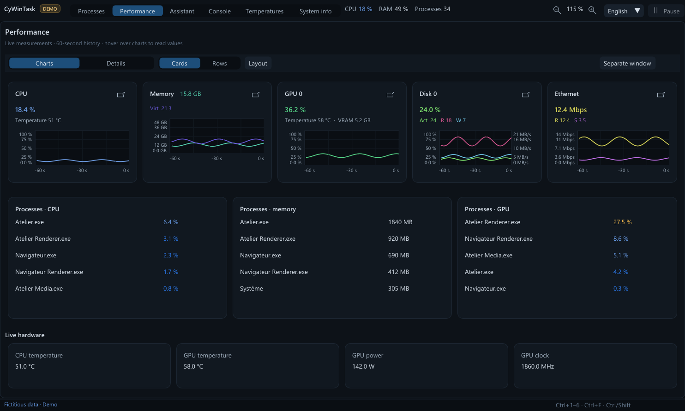
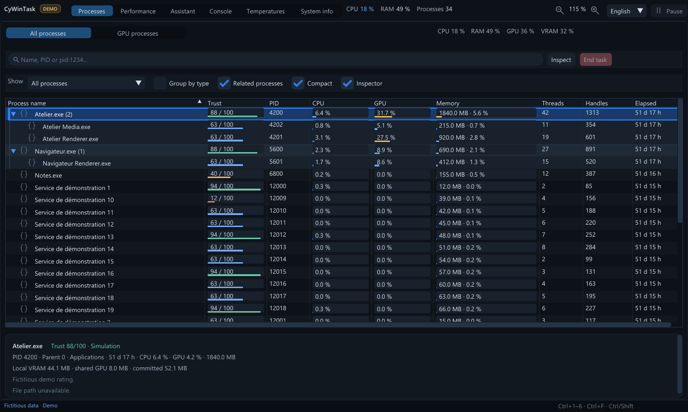

<p align="center"></p>
<h1 align="center">CyWinTask</h1>
<p align="center"><strong>Windows x64 · 0.10.1 · In development</strong></p>
<p align="center"><a href="https://github.com/MrMybal/CyWinTask/releases/download/v0.10.1/CyWinTask-0.10.1-win-x64-setup.exe">Installer</a> · <a href="https://github.com/MrMybal/CyWinTask/releases/download/v0.10.1/CyWinTask-0.10.1-win-x64-portable.zip">Portable ZIP</a> · <a href="https://github.com/MrMybal/CyWinTask/releases/tag/v0.10.1">Release notes</a></p>
<p align="center"><a href="README.fr.md">Français</a> · <a href="LICENSE">GNU AGPL v3.0</a> · <a href="https://github.com/MrMybal/CyWinTask/issues">Issues</a></p>

CyWinTask is a Windows x64 task manager for inspecting running processes and following system activity in real time. Its distributed interface uses Dear ImGui, CyUI and Direct3D 11; a separate .NET 8 collector supplies Windows measurements. CyMCPSDK powers the Assistant and MCP integration.

> **IN DEVELOPMENT · 0.10.1**
>
> The native Windows build is available for testing and analysis. Some Task Manager features remain unfinished; read the [version notes and known limitations](VERSION.md).

[](docs/screenshots/performance.png)

## The application

The **Processes** page searches by name or PID, sorts each column, filters or groups process types, and expands related parent/child processes. Its compact mode shows more rows, process age and a confidence score; the lower panel summarizes the selection. Select rows with Ctrl or Shift, then inspect details or use the right-click menu for available actions. CPU, GPU and memory bars show relative load; process icons appear when accessible. Its **GPU processes** subtab groups processes by GPU adapter and shows trust, CPU/GPU load and local/shared GPU memory. Every column can be sorted; click a row to inspect it or double-click to locate it in the main list. In the flat list, the GPU column measures only that process; in the tree, a parent row includes its descendants. The percentage uses the busiest GPU engine and shows “—” when the Windows counter is unavailable. The inspector also shows per-process local VRAM, shared GPU memory and committed GPU memory when Windows exposes those counters. Stopping a process requires confirmation and revalidates its identity. Children are not stopped implicitly.

The confidence score is a **local indicator** based on Authenticode verification and the executable's location. Verification runs in the background without online revocation checks. Windows catalog signatures may not be confirmed by this check. The score does not establish whether a process is safe or malicious; hover and the inspection panel show the available evidence.

The **Performance** page shows CPU, physical and committed virtual memory, disks, network and GPU. Its graph view fits several resources on screen at once, with grids, value scales, time markers and hover readings. Switch between compact cards and full-width rows, choose cards or rows in resource details, or detach a graph. CyHWInfo supplies CPU and RAM activity, GPU telemetry and available CPU, motherboard and memory sensors; Windows counters remain the fallback. The **Temperatures** page includes a detailed CyHWInfo dashboard with current, minimum, maximum and average readings; it can also read an HWiNFO CSV log. **System info** uses CyHWInfo for CPU, memory, motherboard and GPU inventory. The **Console** keeps a CMD or PowerShell session open between commands with the application's current permissions. An explicit button restarts the app as administrator when deeper sensor access is needed.

[](docs/screenshots/processes.png)

Both screenshots were captured directly from CyWinTask's `--demo` mode with fictional processes and hardware values.

For sensor availability, GPU process columns and hardware requirements, see the [hardware guide](docs/Hardware.fr.md) (French).

## Features

- **Process analysis:** search, sorting, optional type grouping, related-process trees, per-process or branch GPU usage, multiselection, confidence indicator and advanced details.
- **Compact monitoring:** CPU, RAM, GPU, disk and network cards, plus detailed graphs and detachable windows.
- **Hardware tools:** temperature readings, optional HWiNFO CSV sensor log, system overview and local CMD/PowerShell console.
- **Live measurements:** up to 60 seconds of samples; missing counters are shown as unavailable rather than invented.
- **Adjustable interface:** display themes, compact or comfortable density, and zoom controls in the title bar.
- **Assistant and automation:** integrated chat, standalone CLI and local MCP server for measurements, process inspection and UI control. Four local MCP access profiles are available. The default Local controlled profile accepts address-only connections from local processes and keeps per-tool permissions, with a confirmation before ending a process. The Free profile, which allows every registered tool without an extra confirmation, must be selected explicitly. See the [Assistant, CLI and MCP guide](docs/CyMCPSDK.fr.md).

---

## Installation

The published application targets Windows x64. The installer is configured for Windows 10 or later. The process collector includes its .NET runtime. Advanced hardware sensors use a separate .NET 8 bridge and need the [.NET 8 Runtime](https://dotnet.microsoft.com/download/dotnet/8.0). Native measurements remain available without it. Some low-level sensors additionally need the signed [PawnIO driver](https://pawnio.eu/); installation is explicit and may require Windows approval.

1. Download the [0.10.1 installer](https://github.com/MrMybal/CyWinTask/releases/download/v0.10.1/CyWinTask-0.10.1-win-x64-setup.exe) or [portable ZIP](https://github.com/MrMybal/CyWinTask/releases/download/v0.10.1/CyWinTask-0.10.1-win-x64-portable.zip).
2. Run the installer, or extract the **entire** portable ZIP to a folder.
3. Start `CyWinTask.exe`. For the portable build, keep the `bridge` and `cyhwinfo-lhm` folders beside it.

The installer adds a Start menu shortcut and offers an optional desktop shortcut. CyWinTask does not replace Windows Task Manager or its keyboard shortcuts. See the [release and checksums](https://github.com/MrMybal/CyWinTask/releases/tag/v0.10.1).

## Source, build and required libraries

<details>
<summary>Build the native application on Windows</summary>

Install the .NET 8 SDK and Visual Studio 2022 with C++ tools, CMake and Ninja. Building also requires the **private** [CyUI](https://github.com/MrMybal/CyUI), [CyMCPSDK](https://github.com/MrMybal/CyMCPSDK) and [CyHWInfo](https://github.com/MrMybal/CyHWInfo) repositories. Their exact commits are pinned in `native/`; the private sources are not included here. Inno Setup 6 is needed only to build the installer.

```powershell
git clone https://github.com/MrMybal/CyWinTask.git
cd CyWinTask
powershell -NoProfile -ExecutionPolicy Bypass -File native/Sync-CyUI.ps1
powershell -NoProfile -ExecutionPolicy Bypass -File native/Sync-CyMCPSDK.ps1
powershell -NoProfile -ExecutionPolicy Bypass -File native/Build-Native.ps1
./dist-native/CyWinTask.exe
```

`Build-Native.ps1` uses a local `../CyHWInfo` checkout at the pinned revision or clones that revision through your existing GitHub authentication. `-Offline` uses locally cached NuGet packages; `-Checks` runs the local integration checks. Revisions: [CyUI](native/CYUI_REVISION), [CyMCPSDK](native/CYMCP_REVISION) and [CyHWInfo](native/CYHWINFO_REVISION). The build also produces `CyWinTaskCli.exe`. The [integration guide](docs/CyMCPSDK.fr.md) documents commands and MCP connections. To build the installer and portable ZIP locally, run `packaging/Build-Release.ps1` with Inno Setup 6 available. The historical WPF interface remains in the source tree but is not launched by the published packages.

</details>

---

## License

CyWinTask uses the [GNU Affero General Public License v3.0](LICENSE). Third-party components keep their own terms. The table identifies the main components used by the published native build; the complete notices are included in the downloaded application's `licenses` folder.

| Library · source | License · terms | Use / scope |
| --- | --- | --- |
| [CyUI](https://github.com/MrMybal/CyUI) · pinned 1.2.0 source, private repository | MIT; `licenses/CyUI.txt` in the download | Native interface modules Core, Plots and Canvas. |
| [Dear ImGui](https://github.com/ocornut/imgui) · bundled with CyUI | [MIT](https://github.com/ocornut/imgui/blob/master/LICENSE.txt); `licenses/Dear-ImGui.txt` in the download | Native interface rendering. |
| [CyMCPSDK](https://github.com/MrMybal/CyMCPSDK) · pinned 0.7.2 source, private repository | `licenses/CyMCPSDK.txt` in the download | Assistant, tool registry, chat and MCP server. |
| [CyHWInfo](https://github.com/MrMybal/CyHWInfo) · pinned source, private repository | MIT; `licenses/CyHWInfo.txt` in the download | CPU, GPU, memory and motherboard inventory; GPU telemetry; advanced sensor dashboard. |
| [LibreHardwareMonitor](https://github.com/LibreHardwareMonitor/LibreHardwareMonitor) · used by CyHWInfo | MPL-2.0; notices in `cyhwinfo-lhm/licenses/` | Optional CPU, motherboard and memory sensors. |
| [nlohmann/json](https://github.com/nlohmann/json), [cpp-httplib](https://github.com/yhirose/cpp-httplib), [PicoSHA2](https://github.com/okdshin/PicoSHA2) · bundled with CyMCPSDK | Terms in `licenses/nlohmann-json.txt`, `licenses/cpp-httplib.txt` and `licenses/PicoSHA2.txt` | JSON, HTTP and hashing for the assistant integration. |
| [stb text and layout headers](https://github.com/nothings/stb) · bundled with Dear ImGui | MIT **or** public domain at the user's choice; texts in `licenses/stb/` | Font rendering and text/layout helpers used by Dear ImGui. |
| [.NET runtime](https://github.com/dotnet/runtime) · 8.0.31 | [MIT](https://github.com/dotnet/runtime/blob/main/LICENSE.TXT) and component notices | Bundled runtime for the separate collector. |
| [System.Management](https://www.nuget.org/packages/System.Management/8.0.0) · 8.0.0 | [MIT](https://github.com/dotnet/runtime/blob/main/LICENSE.TXT) and component notices | Windows management data used by the collector. |
| [System.CodeDom](https://www.nuget.org/packages/System.CodeDom/8.0.0) · 8.0.0 | [MIT](https://github.com/dotnet/runtime/blob/main/LICENSE.TXT) and component notices | Transitive collector dependency. |

The .NET SDK, Visual Studio C++ tools and Inno Setup are build tools; they are not required to run the published packages. The table is an index, not a replacement for the notices shipped with the application.

## References and links

- [Source repository](https://github.com/MrMybal/CyWinTask) · [Releases](https://github.com/MrMybal/CyWinTask/releases) · [Issue tracker](https://github.com/MrMybal/CyWinTask/issues).
- [Version notes](VERSION.md) · [Français](README.fr.md).
- Windows APIs: [NtQuerySystemInformation](https://learn.microsoft.com/windows/win32/api/winternl/nf-winternl-ntquerysysteminformation), [PDH counters](https://learn.microsoft.com/windows/win32/api/pdh/nf-pdh-pdhgetformattedcounterarrayw), [DXGI](https://learn.microsoft.com/windows/win32/api/dxgi/ns-dxgi-dxgi_adapter_desc1).
